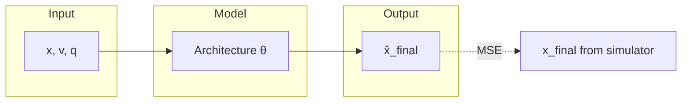
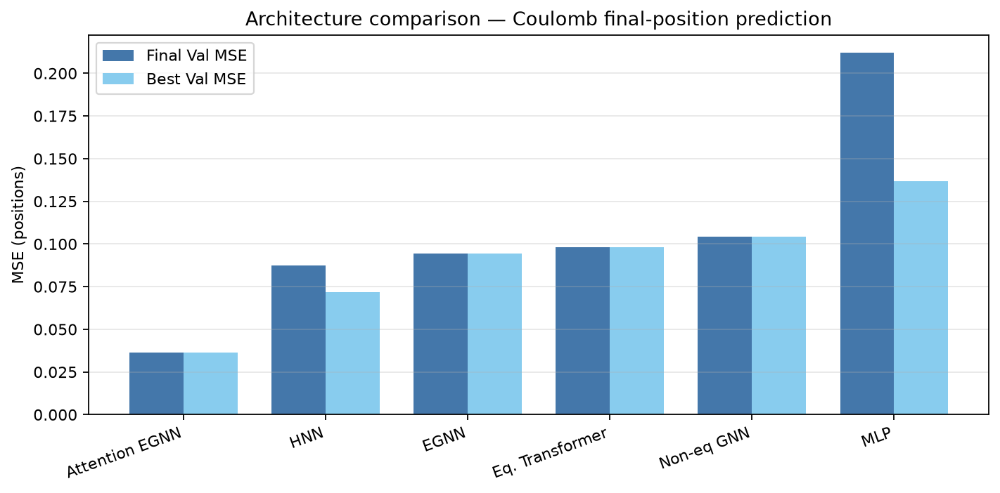
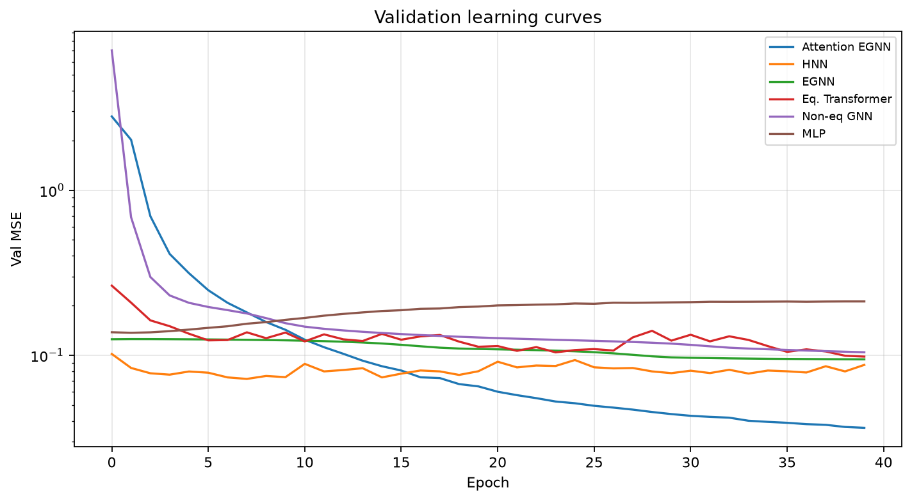
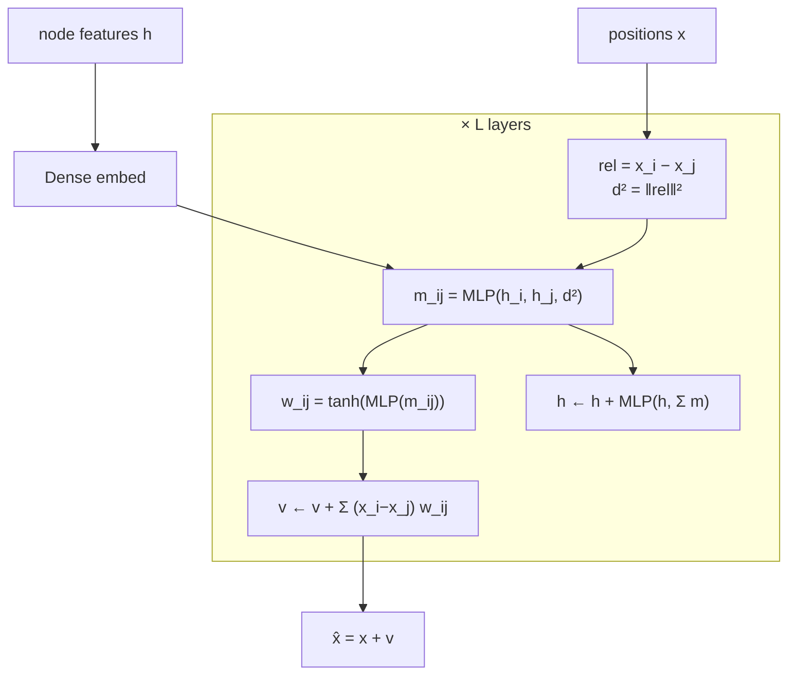
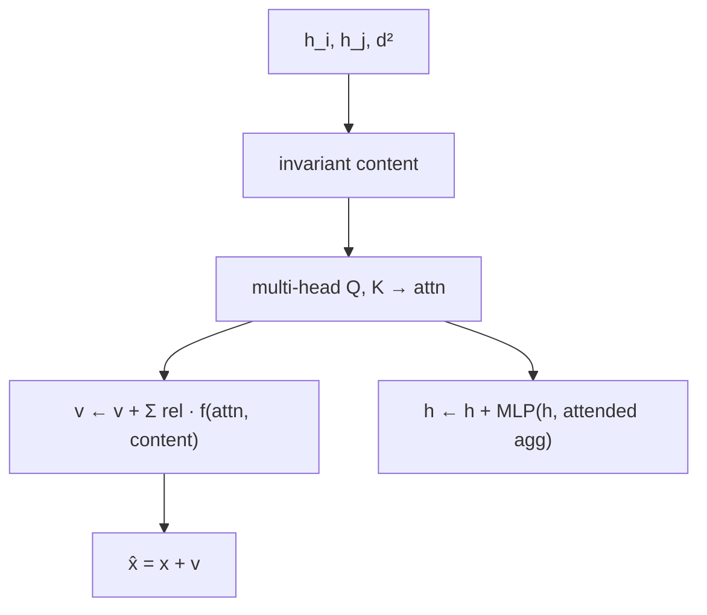
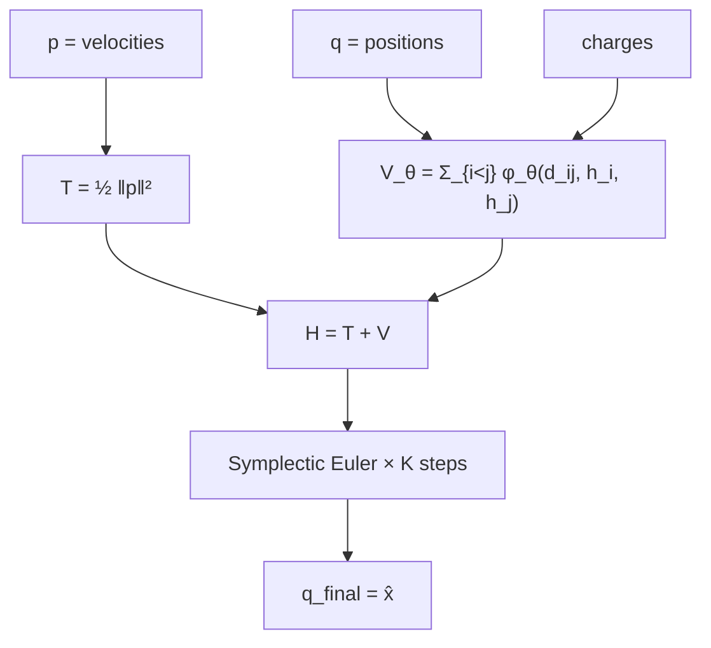
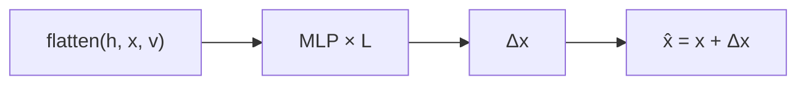
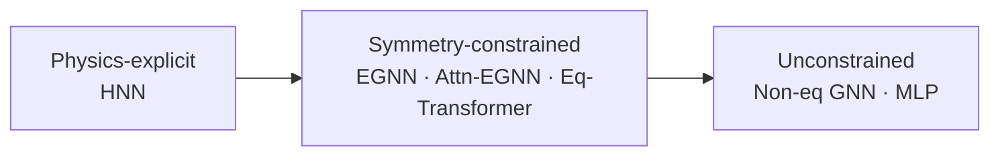

# Architecture Suite Overview

Preliminary benchmark of the models in this repo on the Coulomb dynamics task from the thesis proposal.

**Figures:** [val MSE bars](figures/architecture_val_mse.png) · [learning curves](figures/architecture_learning_curves.png)

---

## What are we predicting?

**Task:** given the initial state of \(N\) charged particles, predict their **positions after time \(T = 1.0\)**.

```text
Input                          Simulator (ground truth)              Target
─────                          ────────────────────────              ──────
positions  x ∈ R^{N×3}         Coulomb force F_ij ∝ q_i q_j r̂ / r²
velocities v ∈ R^{N×3}   ──►   integrate 1000 steps, dt=0.001  ──►  x_final ∈ R^{N×3}
charges    q ∈ {-1,+1}^N       (soft min-distance cutoff r≥0.5)
```

| Piece | Detail |
|-------|--------|
| System | \(N = 10\) particles in 3D |
| Force | \(F_{ij} = q_i q_j \,(x_i-x_j)\,/\,r^3\) (soft cutoff) |
| Integration | Semi-implicit Euler, 1000 steps, \(dt=0.001\) |
| Loss | MSE between predicted and true **final positions** |
| Graph | Fully connected (every pair interacts) |
| Node features | One-hot charge: \([q=-1,\, q=+1]\) |

This is the same family of task as DS 595 Assignment 2 / the thesis testbed: the model must learn dynamics that are consistent with Coulomb physics (or a shortcut that fits the training distribution).



---

## Benchmark setup (this run)

| Setting | Value |
|---------|-------|
| Train / val | 800 / 800 systems |
| Epochs | 40 |
| Optimizer | Adam, lr = 1e-3 |
| Batch size | 64 (HNN: 32) |
| Seed | 0 |
| Scoreboard | `artifacts/runs/bench/scoreboard.json` |

These are **preliminary** scores (smaller data, fewer epochs than a full paper run). Relative ranking is still informative.

---

## Scoreboard

| Rank | Architecture | Tier | Final Val MSE ↓ | Best Val MSE | Train MSE | Notes |
|------|--------------|------|-----------------|--------------|-----------|-------|
| 1 | **Attention EGNN** | Symmetry-constrained | **0.0364** | 0.0364 | 0.0353 | Best overall |
| 2 | **HNN** | Physics-explicit | 0.0875 | **0.0719** | 0.0872 | Best at epoch 8, then drifted |
| 3 | **EGNN** | Symmetry-constrained | 0.0945 | 0.0945 | 0.0947 | Solid baseline |
| 4 | **Eq. Transformer** | Symmetry-constrained | 0.0982 | 0.0982 | 0.0971 | Close to EGNN |
| 5 | **Non-eq GNN** | Unconstrained graph | 0.1043 | 0.1043 | 0.1053 | Slightly worse than EGNN |
| 6 | **MLP** | Fully unconstrained | 0.2119 | 0.1368 | **0.0012** | Overfits hard |





### Quick read of the numbers
- **Attention EGNN** wins: learning which pairs matter helps Coulomb (\(1/r^2\) is sparse in practice).
- **HNN** is competitive and had the best checkpoint mid-run — physics-explicit bias helps, but long integration can be finicky to train.
- **EGNN ≈ Eq. Transformer**: same symmetry idea, different mechanism; similar accuracy so far (good for later CKA / probe comparisons).
- **Non-eq GNN** is a bit worse than EGNN here; on larger data Assignment 2 sometimes saw lower train error but broken equivariance.
- **MLP** memorizes train (MSE ≈ 0.001) and fails to generalize — the control that says “structure matters.”

---

## How each architecture looks

### 1. EGNN — E(3)-equivariant GNN

**Idea:** messages from invariant quantities (features + distance); coordinate updates only along relative vectors \(\Rightarrow\) rotating the input rotates the output.



Config: `configs/egnn_baseline.yaml` · code: `models/egnn.py`

---

### 2. Attention EGNN

**Idea:** same as EGNN, but softmax attention reweights messages (who interacts with whom).


Config: `configs/attention_egnn.yaml` · code: `models/attention_egnn.py`

---

### 3. Equivariant Transformer (lite)

**Idea:** multi-head attention over invariant edge content; attention weights scale relative vectors (still equivariant). **Not** full Equiformer SO(3) irreps — a lighter stand-in for the proposal’s “same symmetry, different mechanism” comparison.



Config: `configs/equivariant_transformer.yaml` · code: `models/eq_transformer.py`

---

### 4. HNN — Hamiltonian Neural Network

**Idea:** physics-explicit. Learn \(H = T(p) + V_\theta(q, \text{charges})\), then integrate Hamilton’s equations:
\(\dot q = \partial H/\partial p\), \(\dot p = -\partial H/\partial q\).



Here \(K=10\), \(dt=0.1\) so total time ≈ 1.0 (matches the simulator horizon).

Config: `configs/hnn.yaml` · code: `models/hnn.py`

---

### 5. Non-equivariant GNN

**Idea:** EGNN backbone, but messages also see **absolute** coordinates \(\Rightarrow\) rotational equivariance is broken.


Config: `configs/non_eq_gnn.yaml` · code: `models/non_eq_gnn.py`

---

### 6. MLP (unconstrained)

**Idea:** flatten everything; no graph, no geometry bias.



Config: `configs/mlp.yaml` · code: `models/mlp.py`

---

## Spectrum (proposal framing)



The thesis question is **not** only “who has lowest MSE?” but whether these tiers learn **different internal representations** of Coulomb physics (probes, causal tests, CKA) — even when output accuracy is similar (EGNN vs Eq. Transformer is a good pair for that).

---

## How to reproduce

```bash
cd /Users/achu/Projects/Interp-Physics
uv sync

# data used for this doc
uv run interp-make-data --out artifacts/data_bench --n-samples 1600 --n-train 800

# re-run all architectures
uv run python scripts/bench_architectures.py
```

Single model:

```bash
uv run interp-train --config configs/attention_egnn.yaml --data artifacts/data_bench
```

---

## Next (for the thesis, not this doc)

1. Linear probes for distance / charge product / force / energy  
2. Equivariance error table alongside MSE  
3. Longer training on full Assignment-2-scale data (2400/4000)  
4. Causal ablation + CKA across the spectrum  
